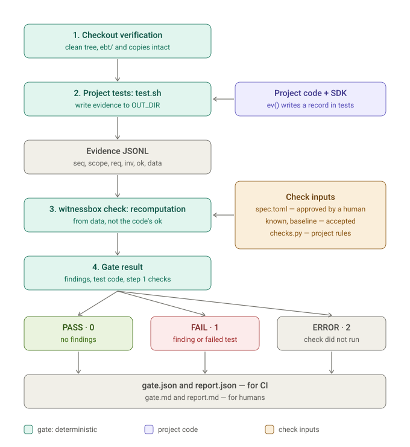

# Архитектура

Поставка устанавливает два entry point из `pyproject.toml`: `ebt-gate` ведёт в `witnessbox.cli:main`, а `ebt-check` — в `witnessbox.checker.ebt_check:main`. Runtime находится в `src/witnessbox/`; пакет `src/ebt_verification/` — только совместимый реэкспорт `witnessbox.api` для существующих проектных чекеров.

## Схема проверки

FAIL получает прогон, в котором выполнено хотя бы одно из условий.

| Условие | Класс в отчёте |
|---|---|
| Пересчёт нашёл нарушение или не подтвердил заявленное кодом | `FALSE_PROOF` (код заявил ok), `CONFIRMED_VIOLATION`, `CHECKER_DISAGREES` |
| Свидетельство нельзя проверить | `WITNESS_INCOMPLETE`, `WITNESS_MALFORMED`, `MALFORMED_LINE` |
| Запись не соответствует spec или чекер не отработал | `UNKNOWN_INV`, `REQ_MISMATCH`, `NO_CHECKER`, `CHECKER_ERROR` |
| Записи потеряны или их нет | `LOG_GAP`, пустой лог |
| Дыра покрытия (с учётом `EBT_INV`) | REQ без INV, INV без записей, непокрытый класс входов, пропавшая из baseline пара «сценарий / инвариант» |
| Чекер не чувствителен к порче поля | `weak_required` из self-test |
| Тесты упали | `test.sh` вернул 1 |
| Изменены проверочные пути или копии | `ebt/` или `tool/ebt_check/` изменены относительно `BASE`; копия из `pinned.txt` отличается или отсутствует |

Находки, совпавшие с `known.toml`, не валят прогон. Изменённые `data` и число записей относительно baseline показываются в отчёте для просмотра, но вердикт не меняют.

ERROR означает, что результат проверки не получен: нет каталога проверки или `spec.toml`, клон грязный или со скрытыми правками, отказ git или ввода-вывода, упал `prepare.sh`, `test.sh` вернул код больше 1, свидетельств нет, чекер вернул код не 0 и не 1 (в том числе некорректные spec, known или расширения), не удалось сохранить изменения прогона в git stash, входы проверки или код поставки изменены во время прогона. ERROR имеет приоритет над FAIL. Все наблюдённые причины перечисляет поле `reasons` в `gate.json`.

## Поток гейта

`cli.py` разбирает аргументы и передаёт управление упакованному `gate.sh`. Shell-гейт проверяет checkout, подготавливает окружение, запускает проектный `test.sh` или выбранный runner, собирает JSONL-свидетельства, вызывает checker из той же установки и формирует отчёты. Flutter runner находится в `runners/flutter.sh`. Проектный каталог EBT задаёт доверенные входы: `spec.toml`, `checks.py` и необязательные `known.toml`, `baseline.jsonl`, `prepare.sh`, `test.sh`, `pinned.txt`.

Checker в `checker/` читает спецификацию и свидетельства, проверяет базовые правила и проектные расширения, применяет scope/baseline/known-контекст и рендерит Markdown/JSON. Он реализует правила самостоятельно и не импортирует приложение или SDK.

## Расширения и ресурсы

`api.py` задаёт типы публичного API расширений; `ebt_verification/api.py` переэкспортирует их без второй реализации и входит в `checker_sha256` вместе с кодом чекера: проектный чекер исполняет совместимый импорт. Стандартные правила и движок находятся в `checker/checkers.py` и `checker/engine.py`; проверка входов и отчёты разделены между `input.py` и `rendering.py`. Практический контракт расширений описан в [extensions](extensions.md).

Java, Dart и TypeScript SDK поставляются как ресурсы пакета в `resources/lib/ebt/`. Формат, допустимые значения и гарантии отключения записи описаны в [sdk](sdk.md). Их тесты лежат в `tests/sdk/`. Установка не требует Python-зависимостей помимо стандартной библиотеки. Сборка, standalone wheel-проверка и SDK-команды описаны в [development](development.md).

Шаблоны нового проекта лежат в `resources/scaffold/`: `spec.toml`, пример `checks.py` и `test_checks.py`, а также `test.sh` и `pinned.txt` для Dart, TypeScript и JVM. `ebt-gate --scaffold` копирует их в новый `ebt/`, не перезаписывая непустой каталог. Шаблоны — данные, а не код проверки: их правка не входит в `gate_sha256`. Инструкция — [заготовка](scaffold.md).

## Границы

Гейт запускает проектные `prepare.sh` и `test.sh` со своими правами, без песочницы. Чекер читает копию входов проверки в `inputs/`, снятую до них, а изменение входов или кода поставки за прогон даёт ERROR. Это обнаружение случайной или наивной порчи, а не защита от намеренного обхода (D26). `OUT_DIR` предназначен для результатов, не для входных данных. Для параллельных тестовых сценариев проект отвечает за порядок и изоляцию данных. Гейт не вводит самостоятельный Runner API или UI.
