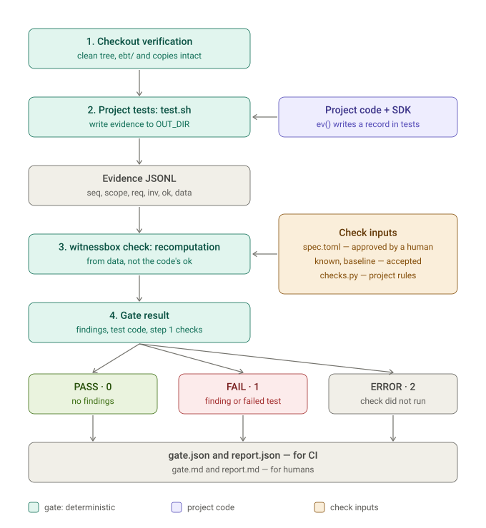

# How it works: one example from start to finish

**English** · [Русский](example.ru.md)

Ordinary tests check what the test author thought about the code. If the same person or agent misunderstood the rule, they will make the same mistake in both the code and the test: the test is green and the behaviour is wrong.

Witnessbox closes this gap. During tests the code records **evidence**: the inputs and the result of its decision. Then a separate program, the **checker**, computes the correct answer again from the approved requirement and compares. The checker does not import application code and does not believe the code's claim "everything is right with me".



Below is each step of the diagram on one example.

## Example: a discount in an online store

The requirement from the product owner:

> Cart total = sum of (price × quantity) over the lines minus the discount. Money is whole kopecks. **A percent discount is rounded down to the kopeck.**

A customer puts three items at 3.33 ₽ each (333 kopecks) into the cart and applies a 15% discount.

- Sum: 333 × 3 = 999 kopecks.
- Discount: 999 × 15% = 149.85 kopecks → **rounded down to 149**.
- Total: 999 − 149 = **850 kopecks**.

## Step 0. The requirement becomes an invariant

Before any code is written, the requirement is formalized in `spec.toml`, and a human approves it. The developer or agent who writes the code does not change this file.

```toml
[req.REQ-CART-1]
text = "Cart total = sum of lines minus the discount. A percent discount is rounded down to the kopeck. ..."

[inv.INV-CART-3]
req = "REQ-CART-1"
checker = "cart_total"                                   # who recomputes
witness = ["lines", "discount", "subtotal", "off", "result"]   # what the code must record
partitions = ["empty_cart", "no_discount", "percent",
              "percent_rounding", "fixed", "fixed_exceeds_subtotal"]  # which cases must occur in the tests
```

- The **invariant** (`INV-CART-3`) is a checkable wording of the requirement: `result = subtotal − off`, where `off` is computed by the discount rule.
- **witness** is the fields without which recomputation is impossible.
- **partitions** are the input partitions. If the tests did not go through at least one of them (for example, there was never a discount with fractional kopecks), the rule is not proven on that partition.

## Step 1. The code records evidence

The developer writes the function and one record line through the SDK. The function has a bug: `Math.round` rounds 149.85 up, to 150.

```ts
import { ev } from './lib/ebt/ebt';

export function cartTotal(lines: [number, number][], percent: number): number {
  const subtotal = lines.reduce((sum, [price, qty]) => sum + price * qty, 0);
  const off = Math.round(subtotal * percent / 100);   // bug: Math.floor is needed
  const result = subtotal - off;
  ev('INV-CART-3', 'REQ-CART-1', result >= 0, () => ({
    lines, discount: { type: 'percent', value: percent }, subtotal, off, result,
  }));
  return result;
}
```

The third argument of `ev()` is the code's claim "everything is fine with me" (`ok`). The checker does not take it into account for the verdict: it only helps to name the finding.

## Step 2. The project tests run and pass

The test is written with the same misunderstanding of the rule, so it is **green**:

```ts
import { writeFileSync } from 'node:fs';
import { Ebt } from './lib/ebt/ebt';

test('15% discount on 999 kopecks', () => {
  expect(cartTotal([[333, 3]], 15)).toBe(849);   // the test author also rounded up
});
afterAll(() => writeFileSync(`${process.env.OUT_DIR}/cart.jsonl`, Ebt.toJsonl()));
```

The gate runs the tests through the project's `test.sh` and passes it an empty `OUT_DIR` directory for the evidence:

```bash
witnessbox gate project/ebt clean-checkout results/
```

Before the run the gate checks the checkout: only committed code is tested, and the verification files (`ebt/`, pinned SDK copies) are unchanged in the branch.

## Step 3. The evidence

During the test, a line appeared in `OUT_DIR/cart.jsonl`:

```json
{"seq":1,"scope":"checkout_discount","req":"REQ-CART-1","inv":"INV-CART-3","ok":true,
 "data":{"lines":[[333,3]],"discount":{"type":"percent","value":15},"subtotal":999,"off":150,"result":849}}
```

`seq` is the sequence number of the record: a skipped number means lost records. `scope` is the test scenario.

## Step 4. The checker recomputes

`witnessbox check` reads `spec.toml`, finds the `cart_total` checker and recomputes from `data`, without looking at the application code:

```
subtotal = 333 × 3          = 999   ✓ matches
off      = 999 × 15 // 100  = 149   ✗ the code recorded 150
```

The code claimed `ok: true`, but the recomputation found a violation. This is the most dangerous class, a **false proof** (`FALSE_PROOF`).

## Step 5. The result

The gate ends with exit code `1`, **FAIL**, although all tests passed. The results directory contains:

- `report.md`, for a human:
  ```
  ### False proof (code: ok, checker: violation) — INV-CART-3
  - Where: line 1, scope checkout_discount, seq 1
  - Code claimed ok=True; checker: violation
  - Reason: off=150, by the discount rule percent:15 it must be 149
  ```
- `gate.json`, for CI:
  ```json
  {"result": "FAIL", "exit_code": 1, "reasons": ["checker_failed"], "tests_exit_code": 0, "checker_exit_code": 1, ...}
  ```

After the fix to `Math.floor`, the test that expects 849 will fail. It will be corrected to 850, the gate will recompute the evidence and give **PASS**, provided that the tests went through all six partitions from `partitions`. The one test in the example covers only `percent` and `percent_rounding`, so in a real project there will be several tests for this rule; otherwise the gate reports a coverage gap.

## What else the gate would catch in this example

| Situation | Result |
|---|---|
| The code did not record `subtotal`, so recomputation is impossible | FAIL: incomplete evidence |
| No test produced a discount greater than the cart sum | FAIL: the `fixed_exceeds_subtotal` partition is not covered |
| The code writes a record with an invariant that is not in `spec.toml` | FAIL: unknown invariant; a new rule must go through approval |
| The checker does not notice corruption of the `off` field (the checker's own check) | FAIL: weak checker |
| `ebt/spec.toml` was changed in the branch to weaken the rule | FAIL when `BASE` is set |
| The tests failed | FAIL, even if the evidence is correct |
| The tests did not run or there is no evidence at all | ERROR: there was no check, and it is not "green" |

## What the product does not do

- It checks only what was recorded. If the code makes a decision and there is no record, the gate will see only an uncovered invariant, not the decision itself.
- `test.sh` and the project's `checks.py` are trusted code, not a sandbox.
- The rule in `spec.toml` must be correct: the checker proves conformance to the approved rule, not that the rule is good. That is why a human approves it.

## Try it

```bash
make example
```

The `examples/basic/` example contains four planted defects, including this rounding case; the report appears in `examples/basic/report.md`. Connecting your own project is covered in [usage](usage.md), the allowed evidence values in the [SDK](sdk.md).
