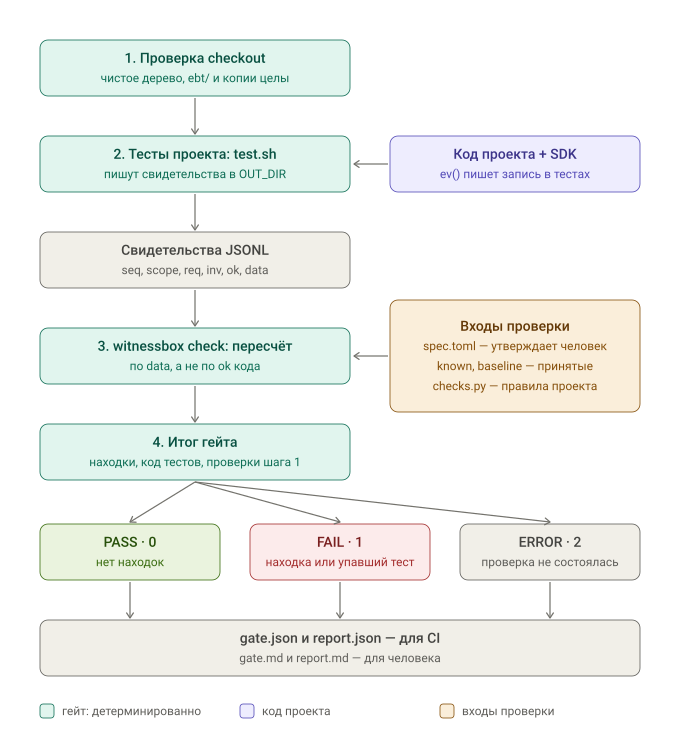

# Как это работает: один пример от начала до конца

[English](example.md) · **Русский**

Обычные тесты проверяют то, что о коде подумал автор тестов. Если тот же человек или агент ошибся в понимании правила, он ошибётся одинаково и в коде, и в тесте: тест будет зелёным, а поведение — неверным.

Witnessbox закрывает этот разрыв. Код во время тестов записывает **свидетельство**: входы и результат своего решения. Затем отдельная программа — **чекер** — заново вычисляет правильный ответ по утверждённому требованию и сравнивает. Чекер не импортирует код приложения и не верит его заявлению «у меня всё правильно».



Ниже — каждый шаг схемы на одном примере.

## Пример: скидка в интернет-магазине

Требование от владельца продукта:

> Итог корзины = сумма (цена × количество) по позициям минус скидка. Деньги — целые копейки. **Процентная скидка округляется вниз до копейки.**

Покупатель кладёт в корзину три товара по 3,33 ₽ (333 копейки) и применяет скидку 15 %.

- Сумма: 333 × 3 = 999 копеек.
- Скидка: 999 × 15 % = 149,85 копейки → **вниз до 149**.
- Итог: 999 − 149 = **850 копеек**.

## Шаг 0. Требование становится инвариантом

До написания кода требование формализуют в `spec.toml`, и его утверждает человек. Разработчик или агент, который пишет код, этот файл не меняет.

```toml
[req.REQ-CART-1]
text = "Итог корзины = сумма позиций минус скидка. Процентная скидка округляется вниз до копейки. ..."

[inv.INV-CART-3]
req = "REQ-CART-1"
checker = "cart_total"                                   # кто пересчитывает
witness = ["lines", "discount", "subtotal", "off", "result"]   # что код обязан записать
partitions = ["empty_cart", "no_discount", "percent",
              "percent_rounding", "fixed", "fixed_exceeds_subtotal"]  # какие случаи должны встретиться в тестах
```

- **Инвариант** (`INV-CART-3`) — проверяемая формулировка требования: `result = subtotal − off`, где `off` считается по правилу скидки.
- **witness** — поля, без которых пересчитать нельзя.
- **partitions** — классы входов. Если тесты не прошли хотя бы один из них (например, ни разу не было скидки с дробными копейками), правило на этом классе не доказано.

## Шаг 1. Код записывает свидетельство

Разработчик пишет функцию и одну строку записи через SDK. В функции ошибка: `Math.round` округляет 149,85 вверх, до 150.

```ts
import { ev } from './lib/ebt/ebt';

export function cartTotal(lines: [number, number][], percent: number): number {
  const subtotal = lines.reduce((sum, [price, qty]) => sum + price * qty, 0);
  const off = Math.round(subtotal * percent / 100);   // ошибка: нужно Math.floor
  const result = subtotal - off;
  ev('INV-CART-3', 'REQ-CART-1', result >= 0, () => ({
    lines, discount: { type: 'percent', value: percent }, subtotal, off, result,
  }));
  return result;
}
```

Третий аргумент `ev()` — заявление кода «у меня всё в порядке» (`ok`). Чекер его не учитывает при вердикте: он только помогает назвать находку.

## Шаг 2. Тесты проекта запускаются и проходят

Тест написан с той же ошибкой в понимании правила, поэтому он **зелёный**:

```ts
import { writeFileSync } from 'node:fs';
import { Ebt } from './lib/ebt/ebt';

test('скидка 15% на 999 копеек', () => {
  expect(cartTotal([[333, 3]], 15)).toBe(849);   // автор теста тоже округлил вверх
});
afterAll(() => writeFileSync(`${process.env.OUT_DIR}/cart.jsonl`, Ebt.toJsonl()));
```

Гейт запускает тесты через проектный `test.sh` и передаёт ему пустой каталог `OUT_DIR` для свидетельств:

```bash
witnessbox gate project/ebt clean-checkout results/
```

Перед запуском гейт проверяет checkout: тестируется только закоммиченный код, а файлы проверки (`ebt/`, закреплённые копии SDK) не изменены в ветке.

## Шаг 3. Свидетельство

Во время теста в `OUT_DIR/cart.jsonl` появилась строка:

```json
{"seq":1,"scope":"checkout_discount","req":"REQ-CART-1","inv":"INV-CART-3","ok":true,
 "data":{"lines":[[333,3]],"discount":{"type":"percent","value":15},"subtotal":999,"off":150,"result":849}}
```

`seq` — порядковый номер записи: пропуск номера означает потерянные записи. `scope` — сценарий теста.

## Шаг 4. Чекер пересчитывает

`witnessbox check` читает `spec.toml`, находит чекер `cart_total` и пересчитывает по `data`, не глядя на код приложения:

```
subtotal = 333 × 3          = 999   ✓ совпало
off      = 999 × 15 // 100  = 149   ✗ код записал 150
```

Код заявил `ok: true`, а пересчёт нашёл нарушение. Это самый опасный класс — **ложное доказательство** (`FALSE_PROOF`).

## Шаг 5. Итог

Гейт завершается с кодом `1` — **FAIL**, хотя все тесты прошли. В каталоге результатов:

- `report.md` для человека:
  ```
  ### Ложное доказательство (код: ok, чекер: нарушение) — INV-CART-3
  - Где: строка 1, scope checkout_discount, seq 1
  - Код заявил ok=True; чекер: нарушение
  - Причина: off=150, по правилу скидки percent:15 должно быть 149
  ```
- `gate.json` для CI:
  ```json
  {"result": "FAIL", "exit_code": 1, "reasons": ["checker_failed"], "tests_exit_code": 0, "checker_exit_code": 1, ...}
  ```

После исправления на `Math.floor` тест с ожиданием 849 упадёт. Его исправят на 850, гейт пересчитает свидетельство и даст **PASS** — если тесты прошли все шесть классов входов из `partitions`. Один тест из примера покрывает только `percent` и `percent_rounding`, поэтому в реальном проекте тестов по этому правилу будет несколько; иначе гейт сообщит дыру покрытия.

## Что ещё гейт поймал бы на этом примере

| Ситуация | Итог |
|---|---|
| Код не записал `subtotal` — пересчитать нельзя | FAIL: неполное свидетельство |
| Ни один тест не дал скидку больше суммы корзины | FAIL: класс `fixed_exceeds_subtotal` не покрыт |
| Код пишет запись с инвариантом, которого нет в `spec.toml` | FAIL: неизвестный инвариант — новое правило должно пройти утверждение |
| Чекер не замечает порчу поля `off` (проверка самого чекера) | FAIL: слабый чекер |
| В ветке изменили `ebt/spec.toml`, чтобы ослабить правило | FAIL при заданном `BASE` |
| Тесты упали | FAIL, даже если свидетельства верны |
| Тесты не запустились или свидетельств нет вовсе | ERROR: проверки не было, это не «зелёный» |

## Чего продукт не делает

- Проверяет только записанное. Если код принимает решение, а записи нет, гейт увидит только непокрытый инвариант, но не само решение.
- `test.sh` и проектный `checks.py` — доверенный код, а не песочница.
- Правило в `spec.toml` должно быть верным: чекер доказывает соответствие утверждённому правилу, а не то, что правило хорошее. Поэтому его утверждает человек.

## Попробовать

```bash
make example
```

Пример `examples/basic/` содержит четыре заложенных дефекта, включая этот случай с округлением; отчёт появится в `examples/basic/report.md`. Подключение своего проекта — в [использовании](usage.ru.md), допустимые значения свидетельств — в [SDK](sdk.ru.md).
